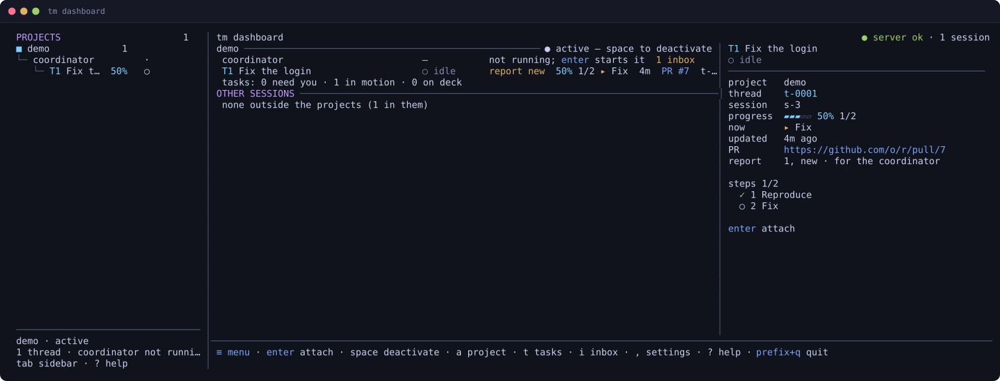
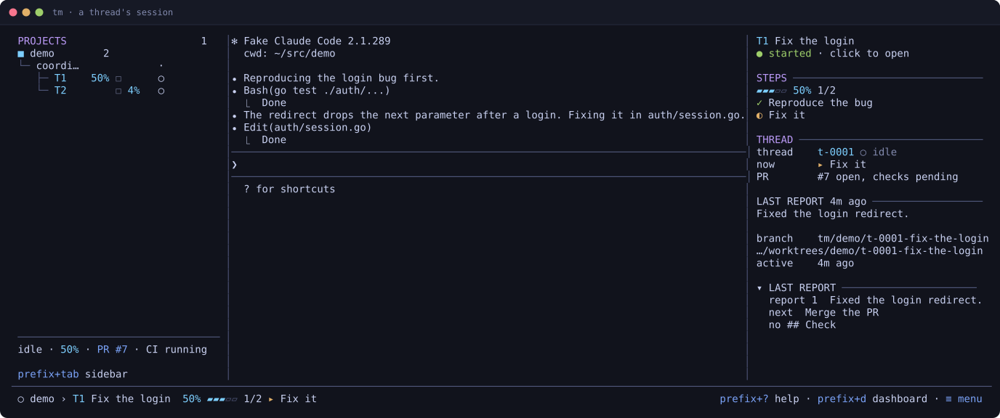
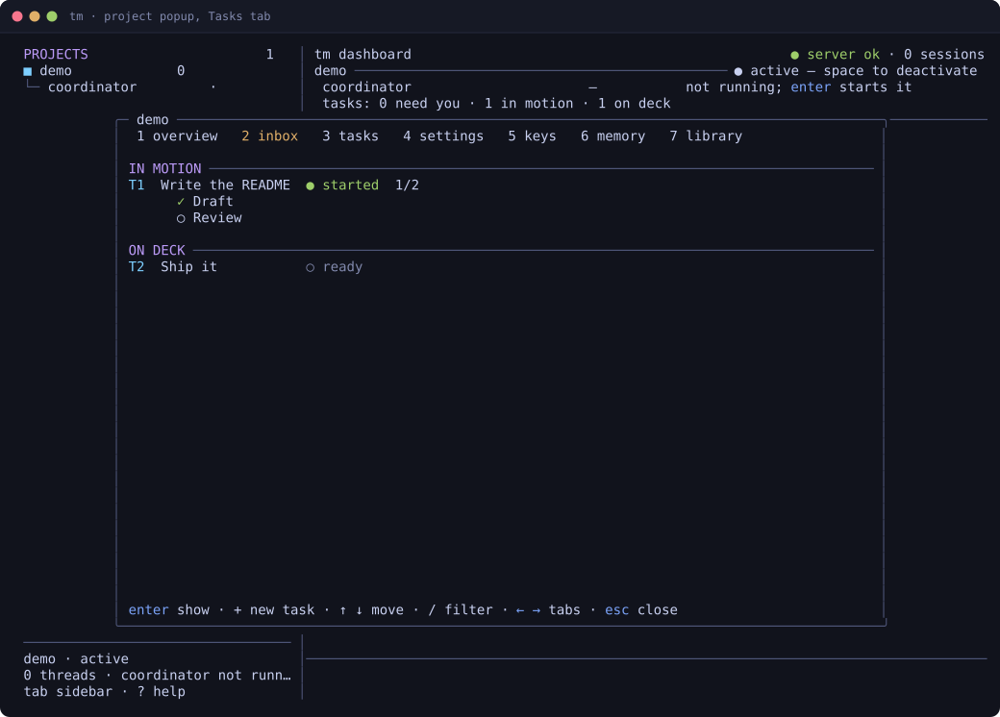
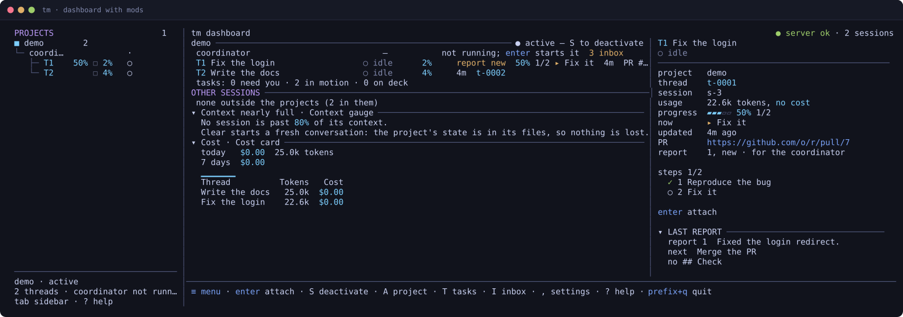
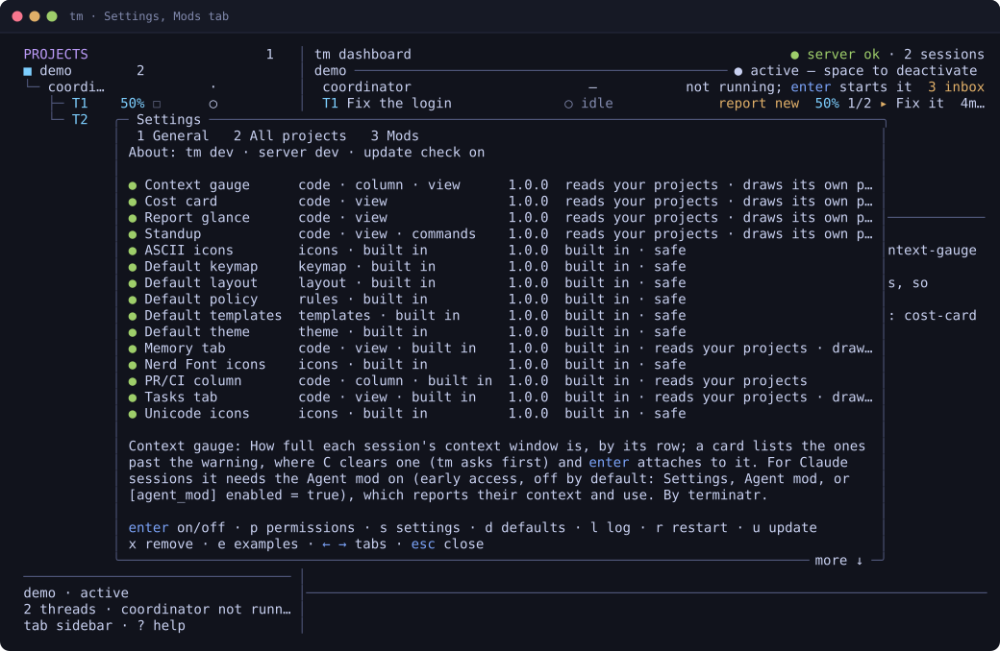

# terminatr

**One terminal for all your coding agents: a coordinator you talk to, threads that do the work.**

You talk to one **coordinator**. It splits the work into tasks and hands each to a **thread**: an agent in its own git worktree that pushes a branch and reports back. `tm`, a single binary, keeps every agent running in a background server when you close the terminal, and its dashboard shows what each one is doing and what waits for you. All progress lives in plain markdown under `~/.terminatr/projects/<slug>/`, so clearing an agent's context loses nothing.

**Claude Code and Codex are supported**; pi and opencode will follow. Agents plug in through a manifest ([docs/SPEC.md §8](docs/SPEC.md#8-agents)). Using Codex? See [docs/CODEX.md](docs/CODEX.md).

tm reads each agent's state from its hooks and session logs, not by scraping the screen. Claude Code sessions get tm's typed tools (`tm mcp`) and show their context and token use, read from Claude's transcript; their state, tasks and pull requests show in tm's dashboard and in the info panel beside the coordinator ([docs/SPEC.md §8.6](docs/SPEC.md#8-agents)).



## A look around

These are tm's own screens, captured by its end-to-end tests (the agent in them is a test stand-in).

On a coordinator's row, on the dashboard or in the sidebar, just start typing: the first key opens the coordinator and everything you type lands in its prompt (the dashboard's keys are `prefix+<key>` there). A thread's row takes `enter` first. On the other rows the dashboard's commands are capitals (`A`, `T`, `S` …), so lower-case text typed into the wrong place does nothing.

Every agent runs in its own session. Open one and tm keeps the project tree on the left and the thread's task, steps, PR and last report on the right; the status bar says where you are and how far it got.



`A` opens the project popup: its overview, inbox, tasks, settings, keys, memory, library and messages (what its coordinator and linked projects' coordinators wrote each other, `tm link`). The Tasks tab shows the board by state, with the selected task's steps; `+` adds a task, from a template if you like.



## Mods

Mods make tm yours. A mod is a folder with a `mod.toml` and, for code, a TypeScript file. It can add dashboard cards, sidebar and dashboard columns, project popup tabs, full views, sections in the details and coordinator panels and in the sidebar (above or below the projects, or under each one), commands (a key, a ≡ menu entry, `prefix`+key inside a session, `tm mod run`), OS notifications with buttons, agent tools served by `tm mcp`, guard rules that only tighten, suggested defaults, themes, keymaps and code hosts (GitLab).



Mods are safe by design. Installing one shows what it asks for, and it installs turned off. Each code mod runs in its own host under the OS sandbox and asks tm for everything. A mod only names an action, such as clearing a session or answering a question; tm checks it and asks you before it runs. Your console talks to the server on a socket of its own that agents' sandboxes don't allow, so an agent can't act as you. `tm --no-mods` starts with the built-in mods only.

Some of tm is mods already: the Tasks tab, the sidebar's PR/CI column, the Memory tab and the default task templates. Settings (`,`) then `4` lists every mod, what it provides and what it may do.



To try one, install it from [the examples](examples/mods) with one line and turn it on in the Mods tab: `tm mod install https://github.com/theclifmeister/terminatr/tree/v0.43.0/examples/mods/standup`. `tm mod install` takes a folder, a git URL, a repository's subfolder (`<git-url>//<folder>@<tag>`) or a GitHub folder's link like this one; in the Mods tab (`,` then `3`), `I` takes the same, and `E` installs an example, each after the same consent. To write your own, run `tm mod new my-mod --kind column`, `tm mod dev my-mod` (live, restarts on save), `tm mod test my-mod` and `tm mod logs my-mod`. In Claude Code sessions, cost-card shows tokens, not a cost: Claude's transcript has none.

## Requirements

macOS 13+, Linux with glibc 2.28+ or Windows (early support) (arm64 or x86_64), git, and at least one agent: [Claude Code](https://claude.com/claude-code) or [Codex](https://developers.openai.com/codex).

## Install

**macOS and Linux, Homebrew:**

```sh
brew tap theclifmeister/terminatr https://github.com/theclifmeister/terminatr
brew trust theclifmeister/terminatr
brew install terminatr
```

**Linux and macOS, no Homebrew** (installs `tm` into `~/.local/bin`, checks the download's sha256):

```sh
curl -fsSL https://github.com/theclifmeister/terminatr/releases/latest/download/install.sh | sh
```

**Windows** (PowerShell, no admin rights; early support):

```powershell
irm https://github.com/theclifmeister/terminatr/releases/latest/download/install.ps1 | iex
```

Newer Homebrew refuses formulas from a tap it doesn't trust, hence `brew trust` once. Then run `tm doctor` to check the setup. Options and manual downloads: [Install in docs/OPERATIONS.md](docs/OPERATIONS.md#install).

## First steps

1. Run `tm`. It starts the background server and opens the dashboard.
2. Press `+` (or `n` while there is none) to create a project, and `enter` on it to start its **coordinator**.
3. Tell the coordinator what you want. It plans tasks and starts threads; open one with `enter` to read along.
4. Press Ctrl+B then `d` to return to the dashboard. Sessions keep running when you close the terminal; `tm` brings you back. `?` lists the keys.

**Security, when you want it.** Agents start the way they run on their own: Claude Code and Codex with their own permission prompts, nothing extra from tm in the way. tm only keeps threads out of the project folder (the coordinator's) and keeps every agent away from your settings and tm's own files. When you want more, raise **Protection** in Settings (`,` then `3`, or a project's Access tab): *guarded* adds the guard's rules (threads write only their worktree, no force-push or pushing to the default branch), *sandboxed* runs Claude threads' commands in a sandbox, and *strict* keeps them there. See [Access in docs/OPERATIONS.md](docs/OPERATIONS.md#access-what-threads-may-do).

## Connect your servers

Run tm on more than one machine (a laptop and a server, say) and pair them: each one's dashboard then shows the projects the other shares, and you can open their panes. The two meet through a relay you run yourself, which both dial out to, so neither needs an open port. The relay sees which servers are paired, their IP addresses, and when and how much they talk, never what they say to each other. A relay that is broken into can cut or slow your links, but can't read or change them.

The relay needs a Linux server with a domain name pointing at it and port 443 open. On that server:

```sh
curl -fsSL https://github.com/theclifmeister/terminatr/releases/latest/download/install.sh | sh
sudo ~/.local/bin/tm relay install --domain relay.example.net
```

The first line puts `tm` in `~/.local/bin`, which `sudo` doesn't search, hence the full path. Homebrew on Linux works too, but is heavy for a small server. The second line installs the relay as a service, gets its certificate from Let's Encrypt and prints the address to pair with. It updates itself daily to the latest release (checksums checked, restarted only for a newer one; `--auto-update=off` to manage it yourself with `sudo tm relay update`: the relay runs its own copy in `/usr/local/bin`, which `brew upgrade` doesn't touch). Any server linked through the relay can also ask it to update now, at most once an hour (once every 10 minutes for all servers together): `U` in the Peers tab, which shows the relay's version, or `tm peer relay-update ALIAS`.

No domain? The relay can run on an IP address instead, public or private (a home network's `192.168.x.x`, a Tailscale `100.x`), with a certificate it makes itself:

```sh
sudo ~/.local/bin/tm relay install --ip 203.0.113.5
```

It prints the address to pair with, which ends in the relay key's fingerprint: `wss://203.0.113.5#sha256=…`. Use that whole address: the servers check the relay by that key instead of by a certificate authority, and the pairing code carries it to the other side. Both servers must reach that IP on port 443, so a private address only works where that network reaches. Back up the relay's state directory (`/var/lib/private/tm-relay`): it holds the key, and a relay set up again with a new key is refused until you give both servers its new address (`tm peer relay ALIAS ADDRESS`, or `E` in the Peers tab).

Then pair two machines: in Settings (`,`), Peers tab, press `N` on one to get a code and `J` on the other to enter it, or in a terminal run `tm peer pair --relay wss://relay.example.net` on one and `tm peer join CODE` on the other. Both show six digits to compare. Docker, a NAS and other setups: [Running a relay in docs/OPERATIONS.md](docs/OPERATIONS.md#running-a-relay).

## Learn more

- [terminatr.dev](https://terminatr.dev): the website
- [docs/CODEX.md](docs/CODEX.md): using Codex
- [docs/OPERATIONS.md](docs/OPERATIONS.md): using, installing, upgrading and operating `tm`
- [docs/SPEC.md](docs/SPEC.md): how it works
- [CONTRIBUTING.md](CONTRIBUTING.md): building from source, tests, pull requests
- [SECURITY.md](SECURITY.md): reporting a vulnerability

## Licence

[MIT](LICENSE) © 2026 Clifmeister.
